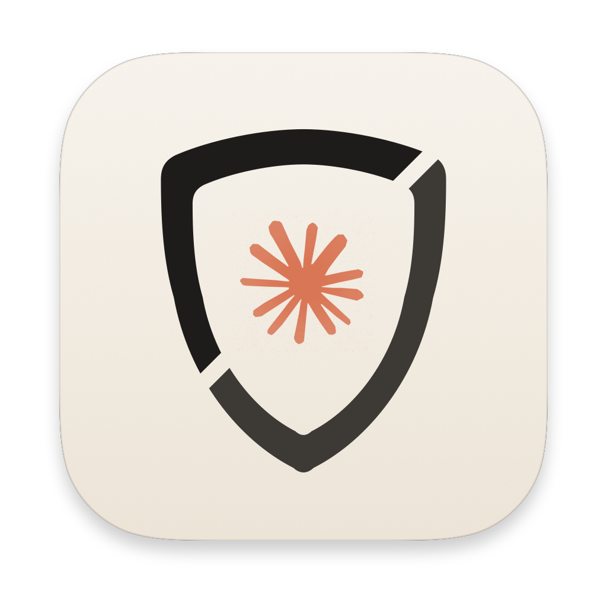

<p align="center">
  
</p>

<h1 align="center">Claude Shield</h1>

<p align="center">
  <strong>下载即用的 macOS 原生 Claude 防封安全套件</strong><br/>
  Rust 原生内核 · SwiftUI 状态栏雷达 · 自动部署全套防线 · 一键无损卸载还原 · 零虚拟机损耗
</p>

<p align="center">
  <a href="https://github.com/luvio-arlan/claude-shield/releases/latest">
    
  </a>
  
  
  
  
</p>

---

## 为什么需要 Claude Shield？

对于长期使用 **Claude Desktop** 与 **Claude Code CLI** 的开发者而言，封号往往不是因为“忘了开代理”，而是死于更隐蔽的细节：

- **休眠唤醒瞬间裸连**：MacBook 合盖唤醒时，系统物理网卡先于 Clash TUN 恢复，后台挂着的 Claude 客户端瞬间以国内真实 IP 发起重连。
- **时区与语言打架**：出口 IP 在洛杉矶，进程时区却是 `Asia/Shanghai`、语言是中文，外加默认遥测与自动更新请求频繁上报。
- **手滑点开原版图标**：桌面版自动更新后会在 `/Applications` 重新生成原版 `Claude.app`，不小心点开就直接绕过代理参数裸跑。
- **隐蔽的 DNS / IPv6 / QUIC / WebRTC 泄露**：Node.js 默认优先 IPv6、Electron 默认走 QUIC/UDP，即使开了代理仍可能泄露真实出口。
- **节点纯净度悄悄劣化**：一直以为是“干净住宅 IP”，实际欺诈分早已飙升或被 Cloudflare 识别为异常地区。

用虚拟机套娃（Lima / Docker）虽然能隔离，却动辄常驻 **2–4GB 内存**、拖慢本地文件 I/O、配置门槛极高。

**Claude Shield v3.1** 用 **原生 Rust 核心引擎 + 原生 SwiftUI 菜单栏应用** 彻底解决这些问题：**下载 App、拖进应用程序、点一下「一键部署」**，无需命令行、无需安装 Rust/Xcode，常驻内存 **< 20MB**；不需要时 **一键卸载并 100% 还原原版应用与所有系统配置**。

---

## 30 秒开箱即用（无需命令行）

### 1. 下载安装

前往 **[GitHub Releases 最新版本](https://github.com/luvio-arlan/claude-shield/releases/latest)** 下载：
- **`Claude-Shield-v3.1.0-macOS-arm64.dmg`**（推荐，双击打开后拖入 `Applications` 文件夹即可）

> **首次打开提示**：由于开源版本采用 Ad-hoc 本地签名（未购买 Apple 付费公证证书），首次打开若遇到 macOS 安全提示，请在终端执行一次即可永久放行：
> ```bash
> xattr -cr "/Applications/Claude Shield.app"
> ```
> 或在「访达 → 应用程序」中 **右键点击 `Claude Shield.app` → 打开**。

### 2. 自动探测 + 一键部署全套防线

首次启动 `Claude Shield.app` 后，会自动弹出 **智能部署向导**：

1. **自动扫描本地代理端口**（支持 Clash Verge Rev `7897`、ClashX `7890`、Surge `6152` 等常见端口）。
2. **自动识别当前出口 IP 与真实时区**（实时读取 `claude.ai` 边缘出口 IP、核对 TUN 一致性，并自动匹配 IP 归属时区如 `America/Los_Angeles`、`Asia/Tokyo`）。
3. 点击 **「一键部署全套防封防护」**，App 自动为您完成全部本地配置：
   - ✅ 锁定白名单专属出口 IP 与本地代理端口
   - ✅ 自动注入进程级时区（`TZ`）与英文语言环境（`LANG=en_US.UTF-8`、`LC_ALL=en_US.UTF-8`）
   - ✅ 自动将原版 `/Applications/Claude.app` 移入隐藏隔离仓并注销启动台 / Spotlight 索引（防手滑裸连）
   - ✅ 自动部署 Claude Code CLI 代理门禁与 IPv4-Only 包装器（并写入 `~/.zshrc` PATH）
   - ✅ 自动部署 OAuth 系统浏览器弹窗拦截器（拦截授权链接并复制到剪贴板，供指纹浏览器打开）
   - ✅ 自动加固 `~/.claude/settings.json`（开启官方 macOS Seatbelt 沙盒、关闭全量遥测与后台自动更新）
   - ✅ 自动开启登录自启状态栏雷达 + 每日 09:30 静默 IP 纯净度巡检

> **核心原则：退出菜单栏监控，底层防护依然全程在线。**
> 关闭状态栏雷达仅退出 UI 进程——已启动的桌面版硬代理绑定、Rust CLI 门禁、OAuth 弹窗拦截、原版隔离仓、Seatbelt 沙盒与每日定时巡检均独立生效。

---

## 一键无损卸载与完整还原

不想再使用 Claude Shield？无需手动翻找配置文件，支持 **App 内一键卸载还原**：

1. 点击菜单栏图标 → 右下角 **「防护设置」** → 在设置窗口左下角点击 **「卸载并还原」**。
2. 确认后，Claude Shield 会自动执行完整还原并在完成后 **弹窗明确提示已还原的全部项目**：
   - ✅ 将隐藏隔离仓中的原版 `Claude.app` 完整移回 `/Applications`，清除隐藏标记并重新注册 Spotlight / 启动台图标
   - ✅ 移除 Claude Code CLI 代理门禁包装器与 OAuth 弹窗拦截器
   - ✅ 精准还原 `~/.claude/settings.json`（仅移除 Claude Shield 注入的时区 / 语言 / 遥测 / 沙盒项，**完整保留您的其他设置**）
   - ✅ 关闭并删除开机自启雷达与每日巡检 LaunchAgent 任务
   - ✅ 清理 `~/.zshrc` 中的 PATH 注入块与 `~/.config/claude-guard` 本地缓存
   - ✅ 将 `Claude Shield.app` 自动移至废纸篓并退出

同样支持终端一键卸载：
```bash
claude-shield uninstall --remove-app
# 或运行仓库脚本
bash scripts/uninstall.sh
```

---

## 十道原生防封防线

| 防线 | 核心机制 | 解决什么痛点 |
| :--- | :--- | :--- |
| **① 零命令行智能部署** | 内置 Rust 核心自动探测代理端口、出口 IP、真实时区，一键部署全套防线并支持随时在「防护设置」中切换节点 | 告别繁琐脚本与手动改配置，普通用户 30 秒上手 |
| **② 三点出口 IP 门禁锁** | 启动前并行校验 **代理 → `claude.ai/cdn-cgi/trace` 边缘** 与 **系统 TUN 路由**，严格匹配白名单并拦截 CN/HK/MO 等封禁地区；检测到 IP 变动或纯净度偏低时弹出原生拦截窗 | 忘开代理、TUN 异常退出、分流规则错乱导致走错节点 |
| **③ `ip.net.coffee` 级纯净度体检** | 并发融合 **Claude Edge + IPPure + ProxyCheck + IP-API + IPInfo + 双通道 EDNS DNS 泄露 + IPv6 泄露 + 时区一致性**，输出 `0-100` 评分与 `S/A/B/C/F` 评级 | 误用被污染机房 IP、隐藏 DNS 泄露或节点突然掉纯度 |
| **④ 运行中硬代理 + 零泄露隔离** | CLI 注入 `HTTP/HTTPS/ALL_PROXY` + `NODE_OPTIONS="--dns-result-order=ipv4first"`；桌面版注入 `--proxy-server` + `--disable-quic` + `--force-webrtc-ip-handling-policy=disable_non_proxied_udp` + `--lang=en-US` | 代理异常回退直连，或 Electron/Node 通过 QUIC/WebRTC/IPv6 泄露真实 IP |
| **⑤ 进程级时区 / 语言 + 零遥测沙盒** | 自动对齐 `TZ` 与出口 IP 时区，锁定 `en_US.UTF-8`，开启官方 Seatbelt 沙盒并关闭所有非必要遥测与后台自动更新 | IP 与时区/语言冲突、多余遥测外联或后台未走代理更新 |
| **⑥ 原版图标隐藏 + 回弹自愈** | 自动将原版 `Claude.app` 移入 `~/.local/apps/`，叠加 `chflags hidden` + `.metadata_never_index` + `lsregister -u` + Dock 清理；若自动更新复活原版图标则立即重新隔离 | 手滑点开原版客户端裸连，或自动更新后出现双图标 |
| **⑦ OAuth 弹窗强制拦截** | 拦截 `open` / `$BROWSER` 对 `claude.ai`、`anthropic.com`、`claude.com` 的系统浏览器拉起，自动复制链接到剪贴板 | 登录/续期时误弹宿主机浏览器造成跨号指纹关联 |
| **⑧ 睡眠唤醒 & 切网 0 秒急停** | 原生监听 macOS `NSWorkspace.didWakeNotification` 与 `NWPathMonitor`，合盖唤醒或切网瞬间复检，发现 IP 漂移或未受保护进程（含桌面版 & 裸奔 CLI）自动急停 | 合盖唤醒瞬间 Clash 未接管导致后台桌面版裸连物理网卡 |
| **⑨ 真实 1-RTT 延迟校准 + 每日巡检** | HTTP/2 Keep-Alive 预热直测 `api.anthropic.com` 剔除冷握手虚高并计算抖动（`API 185ms ±4`）；开机自启雷达 + 每日 09:30 自动深度巡检 | 状态不透明、测速虚高、节点长期劣化无人察觉 |
| **⑩ 一键无损卸载还原** | 原子还原原版 `Claude.app`、系统索引、CLI、Shell 配置与 `settings.json`，完成后明确弹窗反馈全部已还原项 | 担心工具改动系统环境难以清理或损坏原版应用 |

---

## 日常使用与终端诊断命令

1. **安全启动桌面版**：直接从 Spotlight / 启动台 / 菜单栏打开 `Claude Shield`，毫秒级验真并安全拉起 Claude 桌面版。
2. **菜单栏实时雷达**：点击状态栏 `LA 185ms · S` 图标，切换 **「实时雷达」** 与 **「纯净度体检」** 双页签，支持一键测速、一键体检、一键 2x Retina 诊断截图、防护设置与卸载还原。
3. **终端 Claude Code**：直接运行 `claude`，自动经由 Rust 核心极速验真并注入全套防封环境。
4. **终端诊断工具 (`claude-shield`)**：
   ```bash
   claude-shield purity                 # 执行 ip.net.coffee 级多源 IP 纯净度深度体检
   claude-shield patrol                 # 执行全链路安全巡检与防线自愈
   claude-shield detect                 # 探测本地代理端口、出口 IP 与匹配时区
   claude-shield uninstall --remove-app # 一键卸载并完整还原系统环境
   ```

---

## 开发者：从源码编译与打包

> 前置依赖：macOS 13+、Xcode Command Line Tools（`swiftc`）、Rust 工具链（`brew install rust`）

```bash
git clone https://github.com/luvio-arlan/claude-shield.git
cd claude-shield

# 打包独立的 macOS .app / .dmg / .zip（输出至 dist/）
bash scripts/build-release.sh 3.1.0

# 或直接通过命令行安装到本机
bash scripts/install.sh \
  --ip "<YOUR_DEDICATED_IP>" \
  --port "7897" \
  --tz "America/Los_Angeles"
```

> 也支持作为 AI Agent Skill 集成使用：同步至 `~/.gemini/config/skills/claude-shield/` 或 `~/.claude/skills/claude-shield/`，详见 [SKILL.md](./SKILL.md)。

## License

MIT
